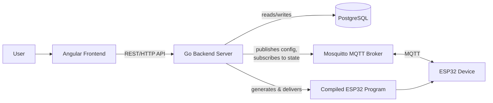
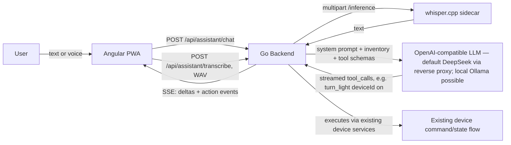

# Fanoos — System Architecture

> Audience: this document is a reference for AI coding agents (and humans) working across this repository. Keep it accurate, unambiguous, and structured. Update it whenever a component, protocol, or repo location changes.

## 1. Project Summary

Fanoos is a home automation platform. Users define a home's electrical/device layout ("environment"), the backend compiles that layout into firmware for a cheap microcontroller (ESP32), and the microcontroller executes it in the field, communicating back to the backend over MQTT.

## 2. Components

| Component | Responsibility | Language / Stack | Repo Location | Status |
|---|---|---|---|---|
| Backend server | User management, personal access tokens, environment/home-architecture definitions, ESP32 program generation, MQTT API, serves the built frontend | Go | `/fanoos` | Active |
| Frontend application | UI for managing users, environments, and home architecture; talks to the backend server; also hosts the mobile PWA (see below) | Angular | `/frontend` | Active |
| MQTT broker | Message bus between the backend and ESP32 devices | Eclipse Mosquitto (Docker image) | — | Planned |
| ESP32 firmware | Executes the compiled home-architecture program on-device; publishes/subscribes to MQTT topics | C/C++ (Arduino) | `/firmware/controller` | Active |
| PostgreSQL database | Persistent storage for the backend server | PostgreSQL | — | Active — see §5 |
| Assistant LLM | Chat/assistant text backend: relays user conversation to an OpenAI-compatible LLM API (device tool-calling planned) | External API (OpenAI-compatible, default DeepSeek via reverse proxy) | — | Active (text chat) — see §9 |
| Whisper STT sidecar | Speech-to-text for assistant voice input (whisper.cpp `whisper-server`) | Docker image `ghcr.nju.edu.cn/ggml-org/whisper.cpp:main` (NJU mirror of `ghcr.io/ggml-org/whisper.cpp:main` — runflare/arvan mirrors don't proxy ghcr.io) | — | Active — see §9 |

## 3. Data Flow

1. User authenticates against the backend and manages environments/home architecture through the frontend.
2. The backend persists all definitions (users, tokens, environments, device layouts) in PostgreSQL.
3. The backend compiles a home-architecture definition into an executable program for the target ESP32 device.
4. At runtime, the backend and ESP32 exchange commands/state over MQTT via the Mosquitto broker (backend never talks to a device directly over TCP).

### Mobile PWA (installable web app)

The mobile experience is a PWA built into the same Angular app — no separate codebase:

- Routes: `/m` (home), `/m/chat` (assistant chat), and `/m/login`, components in `/frontend/src/app/features/mobile`, dark RTL design per `docs/mobile-app-mockup.html`. Scope: login, environment picker, light-circuit toggles (optimistic UI, commands via `POST /api/devices/command/light`, state reconciled by polling `/api/devices/:id/state/light` every 3 s while visible), sensor cards once the backend supports sensor devices, and an assistant chat page (`/m/chat`, opened via the 💬 header button) that streams replies from `POST /api/assistant/chat` (SSE), renders executed device commands (`{"action": …}` events) as inline chips, and keeps the conversation in `localStorage` (`fanoos.mobile.chat`, last 100 messages). The chat page also has a push-to-talk mic button: it records audio, converts it to 16 kHz mono WAV in the browser (`src/app/core/audio/wav.ts`), sends it to `POST /api/assistant/transcribe`, and fills the editable draft with the transcript (never auto-sends) — see §9.
- Auth is shared with the admin panel (same session cookie); the 401 interceptor logs out to the matching area's login (`/m/login` vs `/login`).
- PWA files live in `/frontend/public`: `manifest.webmanifest` (fa/rtl, `start_url: /m`), PNG icons, and a **hand-written service worker** `sw.js` (registered in `src/main.ts` in production builds only — `@angular/service-worker` was not installable because the npm registry was unreachable). Caching strategy: navigations network-first with offline fallback to the cached shell; hashed static assets cache-first; `GET /api/devices/:id/state/*` network-first with a 3 s timeout falling back to the last cached response; everything else (POSTs) network-only.
- Serving requirements: HTTPS (or localhost), `sw.js` at the origin root (it is), and `.webmanifest` with a JSON MIME type (registered explicitly in `fanoos/cmd/web/main.go`).

## 4. Backend Server (`/fanoos`)

- Written in Go.
- Responsibilities:
  - User management (accounts, roles/permissions). `/api/users/create|update|delete` are guarded by `users.{create,update,delete}` resource keys (constants in `internal/app/users/resources.go`; `users.update` seeded in migration `000020`); the `all-users` dataview requires `users.view`. Leaving the password empty on update keeps the current one.
  - Personal access token issuance and validation (used for API auth and, later, device auth).
  - CRUD for "environments" — a home's electrical/device layout (e.g., light locations, switches, desired control behavior). Declaring an environment and modifying its contents — `POST /api/environments/create|update|delete`, device CRUD (`POST /api/devices/create|update|delete`), device links (`POST /api/device-links/create|delete`), and light commands (`POST /api/devices/command/light`) — is guarded by the single resource key `environments.manage` (constant in `internal/app/environment/resources.go`, seeded in migration `000019`). Device state reads (`GET /api/devices/:id/state/*`) and firmware generation (`GET /api/devices/:id/firmware`) require the same key.
  - Compiling an environment definition into an executable ESP32 program.
  - MQTT client/API for communicating with ESP32 devices through the broker. The client lives in `/fanoos/utils/mqttutils`, connects on process startup (auto-reconnecting, non-fatal if the broker is briefly unavailable), and is used by domain packages like `device` to publish commands. `POST /api/devices/command/light` (body: `{deviceId, on}`) looks up the device's environment/GUID/type and publishes `{"on":bool}` to its `cmd` topic. The client also subscribes to every device's `state` topic (`home/+/device/+/state`); each message is persisted to the `device_states` table (keyed by device GUID) via a handler the `device` package registers with `mqttutils.SetStateHandler`, rather than being cached in memory — this keeps state readable/consistent no matter which backend instance handles a given request (running multiple instances still needs a unique `MQTT_CLIENT_ID` per instance, which is not yet solved). `GET /api/devices/:id/state/light` reads that table for a given device (`{on, online, ts, known}`, where `known` is false until a `device_states` row exists for it). `GET /api/devices/:id/state/controller` is the analogous read for a controller — same table, but returns `{online, ts, known}` only, since controllers have no `on` concept (`is_on` is meaningless for them and intentionally omitted).
  - Firmware source generation: `GET /api/devices/:id/firmware` returns `{ino, readme}` for a controller device (the environment editor's "get source code" action). The `internal/app/firmware` package renders two embedded Go `text/template`s (`templates/controller.ino.tmpl`, `templates/README.md.tmpl`) over the controller's linked toggle circuits — the same sketch shape as `/firmware/controller/controller.ino`, with identity/GUIDs baked in from the database and per-circuit GPIOs allocated from a fixed, deterministic pin plan (circuit 1 on the built-in LED, GPIO 2; one output+button pair per circuit; controller button on GPIO 4; max 8 circuits). WiFi/broker settings are placeholders the installer edits in a marked `USER CONFIGURATION` block. The README documents the wiring plan (pins, buttons, relay polarity, power) and how to reorder circuits/remap pins in the generated `CIRCUITS[]` table.
  - Serves the built Angular frontend as static assets (single deployable artifact).
  - AI assistant (chat + device tools): `POST /api/assistant/chat` (session/PAT-protected, body `{messages: [{role, content}]}`) — handler and device tool wiring in `/fanoos/internal/app/assistant/tools`, provider loop in `/fanoos/internal/app/assistant`. The backend prepends a system prompt containing the user's light inventory, declares `turn_light`/`get_light_state` tools, relays the conversation to an **OpenAI-compatible** `/chat/completions` endpoint with `stream: true`, executes the model's tool calls through the existing device services, and pipes everything back as Server-Sent Events: `data: {"delta": "…"}` per text chunk, `data: {"action": {…}}` per executed tool, optional `data: {"error": "…"}`, final `data: [DONE]` (≤5 tool rounds per request). Config via env vars only: `ASSISTANT_BASE_URL`, `ASSISTANT_API_KEY` (required — endpoint returns 503 until set), `ASSISTANT_MODEL` (default `deepseek/deepseek-v4-pro`). Requests to the provider include `Authorization: Bearer <key>`; the key never reaches the frontend. See §9.
  - Assistant voice input (STT): `POST /api/assistant/transcribe` (session/PAT-protected, multipart `audio` field, ≤10 MB) in `/fanoos/internal/app/assistant/tools/transcribe.go` — forwards the audio to the whisper.cpp sidecar's `/inference` endpoint (OpenAI-style JSON response) and returns `{text}`. The whisper sidecar is reachable only from the backend/localhost, never exposed publicly. Config: `WHISPER_URL` (default `http://localhost:8080`). See §9.
- **Authentication** is session-based (`internal/app/auth`): `POST /api/login` verifies the bcrypt password, creates a row in the `sessions` table (SHA-256 hash of a 256-bit random token — the raw token is never stored), and sets it in an `HttpOnly; SameSite=Lax` cookie (`fanoos_session`, 7-day lifetime, `Secure` toggled by `SESSION_COOKIE_SECURE`). `POST /api/auth/logout` deletes the session and clears the cookie. Protected routes authenticate via the cookie or a `Bearer` personal access token (`auth.AuthMiddleware`); `GET /api/auth/resources` returns `{username, resources}` so the frontend can rebuild session state after a refresh. Login is rate-limited (5 failed attempts per 15 min per IP and per username → 429) and returns proper status codes (400/401/429/500).
- Exposes a REST/HTTP API consumed by the Angular frontend.

## 5. Data Storage — PostgreSQL

The backend uses PostgreSQL as its primary datastore. Expected data owned here:

- **Users** — accounts, credentials, roles. User↔role assignment lives in the `user_roles` join table and is managed from the admin UI (`/users/access` split page: pick a user on the left, toggle their roles on the right) via `POST /api/user-roles/list|assign|remove` (handlers in `/fanoos/internal/app/userrole`); `auth.RequireResource` resolves a user's permissions through `user_roles → role_resources → resources`.
- **Personal access tokens** — issued tokens, scopes, expiry, revocation state.
- **Sessions** — server-side login sessions (`token_hash` PK, `user_id` FK with cascade delete, `created_at`/`expires_at`/`last_used_at`); migration `000021`. Deleting a user or a session row immediately revokes the cookie.
- **Environments** — home/device layout definitions (rooms, devices, wiring/control relationships).
- **Devices** — registered ESP32 devices, their identity, and which environment they belong to. Each device has both an internal integer `id` (used only for foreign keys/joins, e.g. `device_links`) and a database-generated `guid` (UUID, unique, immutable) — the `guid` is the external-facing identifier meant for addressing a device from outside the DB (a controller, and later firmware/MQTT), so that never leaks or depends on the sequential internal id.
- **Device state** — `device_states` table, one row per device that has reported over MQTT, keyed by device `guid`: last-known `is_on`, `online`, and report timestamp (`ts`).

Conventions:
- Schema migrations live under `/fanoos/scripts/migrations`.
- The backend connects to PostgreSQL using configuration in `/fanoos/configs`.
- PostgreSQL runs as a service in the local Docker Compose stack (see §6) and as a managed/external instance in production.

## 6. Deployment — Docker Compose

Local development and simple production deployments use Docker Compose to run the stack as a set of containers on a single host:

- `backend` — the Go server (built from `/fanoos`), serves the API and the compiled Angular frontend. A production image is built from `/fanoos/Dockerfile` (multi-stage: Node stage compiles the Angular app into `assets/`, Go stage builds `cmd/web`, minimal Alpine runtime serves on port 3000; the build context is the **repo root** because both `/frontend` and `/fanoos` are needed). Tagging a `v*` tag triggers `.github/workflows/docker-publish.yml`, which pushes the image to `ghcr.io/<owner>/<repo>` using the built-in `GITHUB_TOKEN` (no credentials in source).
- `postgres` — PostgreSQL database, with a named volume for persistent data.
- `mosquitto` — MQTT broker for backend↔ESP32 communication.
- `whisper` — whisper.cpp `whisper-server` sidecar for assistant speech-to-text: it bind-mounts the multilingual `large-v3` model (~3 GB; `base`/`small`/`medium` were tried first but their Persian accuracy was too poor) from `./ggml-large-v3.bin` at the repo root (read-only, git-ignored — containers must not download it on every fresh volume), then serves `/inference` with language fixed to `fa`. If the file is missing, download it once from [huggingface.co/ggerganov/whisper.cpp](https://huggingface.co/ggerganov/whisper.cpp/resolve/main/ggml-large-v3.bin) (blocked on the dev machine — use the [hf-mirror.com mirror](https://hf-mirror.com/ggerganov/whisper.cpp/resolve/main/ggml-large-v3.bin) there) and place it next to `compose.yml`. No public port — bound to `127.0.0.1:8176` on the host only (8080/8081 are taken by other projects on the dev machine), so the backend can reach it during development; when the backend is containerized, set `WHISPER_URL=http://whisper:8080` instead and drop the port mapping. Memory-limited to 8 GB (`mem_limit`; the `large-v3` model is ~3 GB on disk and peaks ~6–8 GB resident). The model can be swapped (e.g. back to `medium` for lower-RAM hosts — the old `ggml-medium.bin` is kept locally as fallback — or quantized variants) by pointing the mount and `-m` flag in `/compose.yml` at the other file.

Notes:
- No Kubernetes is used for this project. The stack is small (single backend instance, single database, single broker) and does not need cluster orchestration.
- `/compose.yml` (repo root) defines the stack. So far only `mosquitto` is wired up (config in `/mosquitto/config/mosquitto.conf`); `backend` and `postgres` services are still to be added.
- Environment-specific configuration (DB credentials, MQTT broker address, session cookie flags) is injected via environment variables / `.env` files, not hardcoded. For local development, the backend also auto-loads a git-ignored `fanoos/.env` at startup (`utils/envutils`, imported before the init-time env readers in `dbutils`/`mqttutils`); real environment variables always override file values.
- Backend MQTT client config: `MQTT_BROKER_URL` (default `tcp://localhost:1883`), `MQTT_CLIENT_ID` (default `fanoos-backend`). Assistant provider config: `ASSISTANT_BASE_URL`, `ASSISTANT_API_KEY`, `ASSISTANT_MODEL` (see §4). Whisper STT config: `WHISPER_URL` (default `http://localhost:8176`, the sidecar's host-mapped port; inside the compose network the sidecar listens on container port 8080). Frontend serving mode (`cmd/web`): unset in production — the server serves the bundled frontend from `./assets` (SPA fallback to `index.html`); setting `DEV_PROXY=1` instead reverse-proxies all non-API routes to the local `ng serve` dev server (target overridable via `DEV_PROXY_TARGET`, default `http://localhost:4201`).

## 7. ESP32 Firmware

- Lives in `/firmware/controller` (Arduino sketch). Built and flashed via Arduino IDE or `arduino-cli`; depends only on `PubSubClient` (Nick O'Leary).
- Runs the program generated by the backend from an environment definition (today: device identity hardcoded into the sketch; later: provisioned at install time).
- Communicates exclusively over MQTT with the broker — no direct connection to the backend or database.
- One physical board opens one MQTT connection and plays two roles over it: the controller itself (reports momentary button presses on its own `state` topic with a Last Will that marks it offline) and every light circuit wired to it (each light has its own independent `cmd`/`state` topics under its own GUID). Local control (physical buttons, relay outputs) keeps working when the network is down — per project principle, manual operation always has priority.
- Open item: device provisioning/authentication flow (how a device obtains its identity and initial config) is not yet defined — today the GUIDs/env ID are baked into `controller.ino` at flash time.
- Until real hardware/firmware exists for a flow, `/fanoos/cmd/simulator` still implements the device side of the MQTT contract below, so backend MQTT integration can be built and tested without ESP32 hardware. Run one process per simulated controller board: it reports its own `press` events (stdin `press`) and drives every light circuit wired to it via `device_links` (`link_type=1`) — applying `cmd` messages from the backend and reporting each circuit's state, plus stdin `<circuit-name> on|off` to simulate a manual toggle. Unlike real firmware, the simulator reads its circuits from Postgres at startup as a dev convenience (see `cmd/simulator/README.md`).

## 8. MQTT Broker (Mosquitto)

- Sits between the backend and all ESP32 devices; runs via `docker compose up mosquitto` (see §6). Anonymous auth is enabled for now (no per-device credentials yet — see open items below).
- Topic naming scheme: `home/{environment_id}/device/{device_guid}/cmd` (backend → device) and `home/{environment_id}/device/{device_guid}/state` (device → backend), where `device_guid` is the `devices.guid` UUID (not the internal integer `id`, which is never exposed to MQTT/firmware). Both are published retained, QoS 1.
- Payload shape (JSON):
  - Light state: `{"type":"light","on":bool,"online":bool,"ts":unix_seconds}`
  - Light cmd: `{"on":bool}`
  - Controller state: `{"type":"controller","pressed":bool,"online":bool,"ts":unix_seconds}` — a momentary event (`pressed:true` immediately followed by `pressed:false`), not a persistent mode. Controllers do not currently accept a `cmd`.
  - A device's Last Will is `{"online":false,"ts":unix_seconds}` on its state topic, so the broker reports it offline if it disconnects uncleanly.
  - `device_links.link_type` is a SMALLINT constrained to 1–4 (CHECK), with only one value defined today: `1` = toggle (controller acts as a physical switch for the linked light). The `devices` table's internal integer `id` is what `device_links` foreign keys reference (not `devices.guid`), since that table is backend-internal and never exposed over MQTT. The unique constraint `UNIQUE(source_device_id, target_device_id)` (no `link_type` in it) means only one link can exist between a given controller/light pair.
- Still open before production use:
  - Per-device authentication and topic-level ACLs (a device should only access its own topics).
  - TLS for broker connections.

## 9. AI Assistant

Natural-language layer, implemented in three phases. **Status: phases 1 (text chat), 2 (tool-calling device control), and 3 (push-to-talk voice input) implemented.**

**Phase 1 — text chat:** the mobile PWA's chat page (`/m/chat`) sends the conversation to `POST /api/assistant/chat`; the backend relays it to an OpenAI-compatible provider (config above) and streams the reply back over SSE.

**Phase 2 — tool-calling device control:** the backend injects the user's light inventory (compact JSON: id, name, environment, last reported on/online state from `device_states`) into the system prompt and declares two function tools — `turn_light(deviceId, on)` and `get_light_state(deviceId)`, both executing through the same service functions as the REST API (`device.SendLightCommand` / `device.GetLightState`). When the model requests tool calls, the backend executes each one immediately, emits an `{"action": {...}}` SSE event (with a ready-made Persian summary like `💡 چراغ آشپزخانه روشن شد`) that the chat UI renders as an inline chip, feeds the JSON result back to the model as `role:"tool"` messages, and streams the follow-up reply. The loop runs at most 5 rounds per request. Code layout: `internal/app/assistant` is the pure provider loop (streaming, tool-call fragment reassembly, message sanitizing — no DB imports, unit-tested with an httptest fake); `internal/app/assistant/tools` owns the HTTP endpoint, the inventory query, tool schemas, and the device executor.

**Phase 3 — voice input (push-to-talk):** the chat page's 🎤 button records audio with `MediaRecorder` (max 60 s), converts it in-browser to 16 kHz mono WAV (`src/app/core/audio/wav.ts` — the browser's decoder handles webm/opus and mp4/aac, whisper gets a format it accepts natively), and uploads it to `POST /api/assistant/transcribe`. The backend forwards the file to the whisper.cpp sidecar (§6) and returns the transcript, which **fills the editable draft — it is never auto-sent**: a mis-heard device name must not toggle the wrong light, so the user always reviews the text before it enters the LLM pipeline (everything downstream is unchanged phase 1/2 text flow). STT runs server-side by design: the client only captures audio (a browser PWA can't run always-on wake-word listening anyway), the model (multilingual `medium`, language pinned to `fa`) lives in one place for all clients, and audio stays on the user's own server.

Design decisions:

- **Server-side only.** The ESP32 firmware and MQTT contract are untouched — devices keep working fully offline; the assistant is a pure backend layer over existing APIs. This preserves the project principle that smart features never reduce reliability.
- **Auth:** the chat endpoint executes *as the requesting user* (same session/PAT). Note: environments have no per-user ownership yet, so — like `POST /api/devices/command/light` — the assistant can command any environment's devices; scoping waits on the ownership model. The LLM never gets a privileged/god token (it only receives tool *results*, never backend credentials).
- **Tools are the existing APIs.** The tool-calling format just needs a JSON schema per tool; v1 tool set is deliberately tiny: `turn_light(deviceId, on)` (wraps the same logic as `POST /api/devices/command/light`) and `get_light_state(deviceId)`. Fewer tools → fewer hallucinated calls.
- **Entity resolution:** environments are small, so the backend injects the user's device inventory (room names, device labels, GUIDs, current states) into the system prompt as compact JSON; the LLM picks the right GUID in one shot. Only add a `list_devices` tool if environments grow large.
- **Provider abstraction:** the wire format is OpenAI-compatible across providers, so config chooses cloud (default: DeepSeek through the `open-router-reverse` proxy) or local (Ollama, e.g. qwen2.5) — users who don't want their home layout in a third-party cloud can run fully local. Config via environment variables (`ASSISTANT_BASE_URL`, `ASSISTANT_API_KEY`, `ASSISTANT_MODEL`), never hardcoded.
- **Latency:** stream the LLM reply to the frontend and execute each tool call as soon as it's parsed — don't wait for the full response text.
- **Confirm/act pattern:** the LLM returns intent, the backend executes and reports the result ("Turned on kitchen light ✓"). This gate is in place for when irreversible device types (locks, heating) arrive.
- **Voice input (phase 3):** push-to-talk STT runs server-side (whisper.cpp sidecar) — see above. The transcript always lands in the editable draft as a safety gate. Hands-free wake-word listening ("هی بازارینو") is a possible later step: browser PWAs cannot listen in the background, so it would need a native app wrapper or an opt-in foreground listening mode.

## 10. Open Questions / Not Yet Decided

- Device provisioning flow (how an ESP32 gets its first config/credentials).
- Per-device MQTT authentication and topic-level access control.
- Backend-side mediation of `device_links` over MQTT (subscribing to controller state, publishing commands to linked lights) for the toggle link type.
- Real-time state push to the frontend (likely WebSockets/SSE from the backend) — not yet specified.
- `device_links` foreign keys still reference `devices.id` (internal), not `devices.guid` — fine for now since that table is backend-internal and never exposed over MQTT.
- Assistant voice input: push-to-talk STT is implemented (§9 phase 3) with the multilingual `small` model; open items are whether `small`'s Persian accuracy is enough in practice (next tiers: `medium`, or `large-v3-turbo` if the host allows), and whether a wake-word/hands-free mode is worth adding (requires foreground listening or a native wrapper).
- Assistant safety policy: what confirmation (if any) to require before executing commands that affect irreversible or safety-relevant device types once they exist (locks, heating).
