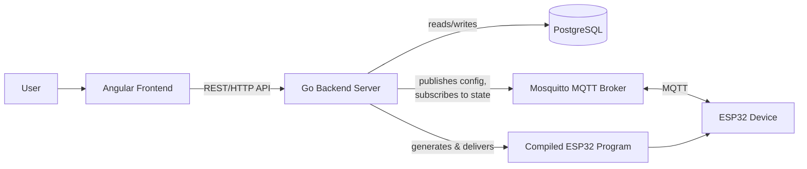

# Marketino — System Architecture

> Audience: this document is a reference for AI coding agents (and humans) working across this repository. Keep it accurate, unambiguous, and structured. Update it whenever a component, protocol, or repo location changes.

## 1. Project Summary

Marketino is a home automation platform. Users define a home's electrical/device layout ("environment"), the backend compiles that layout into firmware for a cheap microcontroller (ESP32), and the microcontroller executes it in the field, communicating back to the backend over MQTT.

## 2. Components

| Component | Responsibility | Language / Stack | Repo Location | Status |
|---|---|---|---|---|
| Backend server | User management, personal access tokens, environment/home-architecture definitions, ESP32 program generation, MQTT API, serves the built frontend | Go | `/marketino` | Active |
| Frontend application | UI for managing users, environments, and home architecture; talks to the backend server | Angular | `/new-angular-project` | Active |
| MQTT broker | Message bus between the backend and ESP32 devices | Eclipse Mosquitto (Docker image) | — | Planned |
| ESP32 firmware | Executes the compiled home-architecture program on-device; publishes/subscribes to MQTT topics | C/C++ (Arduino or ESP-IDF) | TBD | Planned |
| PostgreSQL database | Persistent storage for the backend server | PostgreSQL | — | Active — see §5 |

## 3. Data Flow

1. User authenticates against the backend and manages environments/home architecture through the frontend.
2. The backend persists all definitions (users, tokens, environments, device layouts) in PostgreSQL.
3. The backend compiles a home-architecture definition into an executable program for the target ESP32 device.
4. At runtime, the backend and ESP32 exchange commands/state over MQTT via the Mosquitto broker (backend never talks to a device directly over TCP).

## 4. Backend Server (`/marketino`)

- Written in Go.
- Responsibilities:
  - User management (accounts, roles/permissions).
  - Personal access token issuance and validation (used for API auth and, later, device auth).
  - CRUD for "environments" — a home's electrical/device layout (e.g., light locations, switches, desired control behavior).
  - Compiling an environment definition into an executable ESP32 program.
  - MQTT client/API for communicating with ESP32 devices through the broker.
  - Serves the built Angular frontend as static assets (single deployable artifact).
- Exposes a REST/HTTP API consumed by the Angular frontend.

## 5. Data Storage — PostgreSQL

The backend uses PostgreSQL as its primary datastore. Expected data owned here:

- **Users** — accounts, credentials, roles.
- **Personal access tokens** — issued tokens, scopes, expiry, revocation state.
- **Environments** — home/device layout definitions (rooms, devices, wiring/control relationships).
- **Devices** — registered ESP32 devices, their identity, and which environment they belong to.
- **Device state / history** *(optional, if needed later)* — last-known state or event history reported over MQTT.

Conventions:
- Schema migrations live under `/marketino/scripts/migrations`.
- The backend connects to PostgreSQL using configuration in `/marketino/configs`.
- PostgreSQL runs as a service in the local Docker Compose stack (see §6) and as a managed/external instance in production.

## 6. Deployment — Docker Compose

Local development and simple production deployments use Docker Compose to run the stack as a set of containers on a single host:

- `backend` — the Go server (built from `/marketino`), serves the API and the compiled Angular frontend.
- `postgres` — PostgreSQL database, with a named volume for persistent data.
- `mosquitto` — MQTT broker for backend↔ESP32 communication.

Notes:
- No Kubernetes is used for this project. The stack is small (single backend instance, single database, single broker) and does not need cluster orchestration.
- The `docker-compose.yml` (to be added under `/marketino/build/package` or repo root) should define these three services plus any shared network and persistent volumes.
- Environment-specific configuration (DB credentials, MQTT broker address, token signing secrets) is injected via environment variables / `.env` files, not hardcoded.

## 7. ESP32 Firmware

- Not yet developed.
- Will run the program generated by the backend from an environment definition.
- Communicates exclusively over MQTT with the broker — no direct connection to the backend or database.
- Open item: device provisioning/authentication flow (how a device obtains its identity and initial config) is not yet defined.

## 8. MQTT Broker (Mosquitto)

- Not yet developed/configured.
- Sits between the backend and all ESP32 devices.
- Open items to define before implementation:
  - Topic naming scheme (e.g., `home/{environment_id}/device/{device_id}/cmd` and `.../state`).
  - Per-device authentication and topic-level ACLs (a device should only access its own topics).
  - TLS for broker connections.

## 9. Open Questions / Not Yet Decided

- Device provisioning flow (how an ESP32 gets its first config/credentials).
- MQTT topic schema and per-device access control.
- Real-time state push to the frontend (likely WebSockets/SSE from the backend) — not yet specified.
