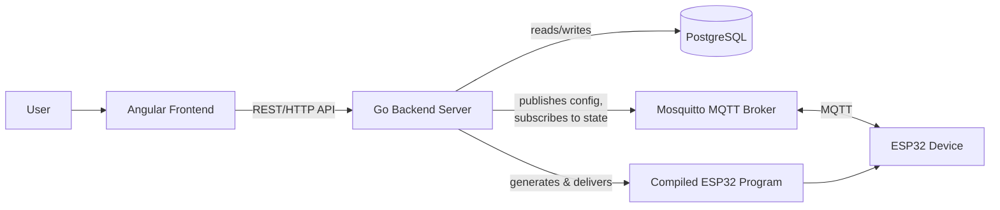

# Marketino — System Architecture

> Audience: this document is a reference for AI coding agents (and humans) working across this repository. Keep it accurate, unambiguous, and structured. Update it whenever a component, protocol, or repo location changes.

## 1. Project Summary

Marketino is a home automation platform. Users define a home's electrical/device layout ("environment"), the backend compiles that layout into firmware for a cheap microcontroller (ESP32), and the microcontroller executes it in the field, communicating back to the backend over MQTT.

## 2. Components

| Component | Responsibility | Language / Stack | Repo Location | Status |
|---|---|---|---|---|
| Backend server | User management, personal access tokens, environment/home-architecture definitions, ESP32 program generation, MQTT API, serves the built frontend | Go | `/marketino` | Active |
| Frontend application | UI for managing users, environments, and home architecture; talks to the backend server | Angular | `/new-angular-project` | Active |
| MQTT broker | Message bus between the backend and ESP32 devices | Eclipse Mosquitto (Docker image) | — | Planned |
| ESP32 firmware | Executes the compiled home-architecture program on-device; publishes/subscribes to MQTT topics | C/C++ (Arduino or ESP-IDF) | TBD | Planned |
| PostgreSQL database | Persistent storage for the backend server | PostgreSQL | — | Active — see §5 |

## 3. Data Flow

1. User authenticates against the backend and manages environments/home architecture through the frontend.
2. The backend persists all definitions (users, tokens, environments, device layouts) in PostgreSQL.
3. The backend compiles a home-architecture definition into an executable program for the target ESP32 device.
4. At runtime, the backend and ESP32 exchange commands/state over MQTT via the Mosquitto broker (backend never talks to a device directly over TCP).

## 4. Backend Server (`/marketino`)

- Written in Go.
- Responsibilities:
  - User management (accounts, roles/permissions).
  - Personal access token issuance and validation (used for API auth and, later, device auth).
  - CRUD for "environments" — a home's electrical/device layout (e.g., light locations, switches, desired control behavior).
  - Compiling an environment definition into an executable ESP32 program.
  - MQTT client/API for communicating with ESP32 devices through the broker. The client lives in `/marketino/utils/mqttutils`, connects on process startup (auto-reconnecting, non-fatal if the broker is briefly unavailable), and is used by domain packages like `device` to publish commands. `POST /api/devices/command/light` (body: `{deviceId, on}`) looks up the device's environment/GUID/type and publishes `{"on":bool}` to its `cmd` topic. The client also subscribes to every device's `state` topic (`home/+/device/+/state`); each message is persisted to the `device_states` table (keyed by device GUID) via a handler the `device` package registers with `mqttutils.SetStateHandler`, rather than being cached in memory — this keeps state readable/consistent no matter which backend instance handles a given request (running multiple instances still needs a unique `MQTT_CLIENT_ID` per instance, which is not yet solved). `GET /api/devices/:id/state/light` reads that table for a given device (`{on, online, ts, known}`, where `known` is false until a `device_states` row exists for it). `GET /api/devices/:id/state/controller` is the analogous read for a controller — same table, but returns `{online, ts, known}` only, since controllers have no `on` concept (`is_on` is meaningless for them and intentionally omitted).
  - Serves the built Angular frontend as static assets (single deployable artifact).
- Exposes a REST/HTTP API consumed by the Angular frontend.

## 5. Data Storage — PostgreSQL

The backend uses PostgreSQL as its primary datastore. Expected data owned here:

- **Users** — accounts, credentials, roles.
- **Personal access tokens** — issued tokens, scopes, expiry, revocation state.
- **Environments** — home/device layout definitions (rooms, devices, wiring/control relationships).
- **Devices** — registered ESP32 devices, their identity, and which environment they belong to. Each device has both an internal integer `id` (used only for foreign keys/joins, e.g. `device_links`) and a database-generated `guid` (UUID, unique, immutable) — the `guid` is the external-facing identifier meant for addressing a device from outside the DB (a controller, and later firmware/MQTT), so that never leaks or depends on the sequential internal id.
- **Device state** — `device_states` table, one row per device that has reported over MQTT, keyed by device `guid`: last-known `is_on`, `online`, and report timestamp (`ts`).

Conventions:
- Schema migrations live under `/marketino/scripts/migrations`.
- The backend connects to PostgreSQL using configuration in `/marketino/configs`.
- PostgreSQL runs as a service in the local Docker Compose stack (see §6) and as a managed/external instance in production.

## 6. Deployment — Docker Compose

Local development and simple production deployments use Docker Compose to run the stack as a set of containers on a single host:

- `backend` — the Go server (built from `/marketino`), serves the API and the compiled Angular frontend.
- `postgres` — PostgreSQL database, with a named volume for persistent data.
- `mosquitto` — MQTT broker for backend↔ESP32 communication.

Notes:
- No Kubernetes is used for this project. The stack is small (single backend instance, single database, single broker) and does not need cluster orchestration.
- `/compose.yml` (repo root) defines the stack. So far only `mosquitto` is wired up (config in `/mosquitto/config/mosquitto.conf`); `backend` and `postgres` services are still to be added.
- Environment-specific configuration (DB credentials, MQTT broker address, token signing secrets) is injected via environment variables / `.env` files, not hardcoded.
- Backend MQTT client config: `MQTT_BROKER_URL` (default `tcp://localhost:1883`), `MQTT_CLIENT_ID` (default `marketino-backend`).

## 7. ESP32 Firmware

- Not yet developed.
- Will run the program generated by the backend from an environment definition.
- Communicates exclusively over MQTT with the broker — no direct connection to the backend or database.
- Open item: device provisioning/authentication flow (how a device obtains its identity and initial config) is not yet defined.
- Until real hardware/firmware exists, `/marketino/cmd/simulator` implements the device side of the MQTT contract below, so backend MQTT integration can be built and tested without ESP32 hardware. Run one process per simulated controller board: it reports its own `press` events (stdin `press`) and drives every light circuit wired to it via `device_links` (`link_type="circuit"`) — applying `cmd` messages from the backend and reporting each circuit's state, plus stdin `<circuit-name> on|off` to simulate a manual toggle. Unlike real firmware, the simulator reads its circuits from Postgres at startup as a dev convenience (see `cmd/simulator/README.md`).

## 8. MQTT Broker (Mosquitto)

- Sits between the backend and all ESP32 devices; runs via `docker compose up mosquitto` (see §6). Anonymous auth is enabled for now (no per-device credentials yet — see open items below).
- Topic naming scheme: `home/{environment_id}/device/{device_guid}/cmd` (backend → device) and `home/{environment_id}/device/{device_guid}/state` (device → backend), where `device_guid` is the `devices.guid` UUID (not the internal integer `id`, which is never exposed to MQTT/firmware). Both are published retained, QoS 1.
- Payload shape (JSON):
  - Light state: `{"type":"light","on":bool,"online":bool,"ts":unix_seconds}`
  - Light cmd: `{"on":bool}`
  - Controller state: `{"type":"controller","pressed":bool,"online":bool,"ts":unix_seconds}` — a momentary event (`pressed:true` immediately followed by `pressed:false`), not a persistent mode. Controllers do not currently accept a `cmd`.
  - A device's Last Will is `{"online":false,"ts":unix_seconds}` on its state topic, so the broker reports it offline if it disconnects uncleanly.
  - `device_links.link_type` is a SMALLINT constrained to 1–4 (CHECK), with only one value defined today: `1` = toggle (controller acts as a physical switch for the linked light). The `devices` table's internal integer `id` is what `device_links` foreign keys reference (not `devices.guid`), since that table is backend-internal and never exposed over MQTT. The unique constraint `UNIQUE(source_device_id, target_device_id)` (no `link_type` in it) means only one link can exist between a given controller/light pair.
- Still open before production use:
  - Per-device authentication and topic-level ACLs (a device should only access its own topics).
  - TLS for broker connections.

## 9. Open Questions / Not Yet Decided

- Device provisioning flow (how an ESP32 gets its first config/credentials).
- Per-device MQTT authentication and topic-level access control.
- Backend-side mediation of `device_links` over MQTT (subscribing to controller state, publishing commands to linked lights) for the toggle link type.
- Real-time state push to the frontend (likely WebSockets/SSE from the backend) — not yet specified.
- `device_links` foreign keys still reference `devices.id` (internal), not `devices.guid` — fine for now since that table is backend-internal and never exposed over MQTT.
