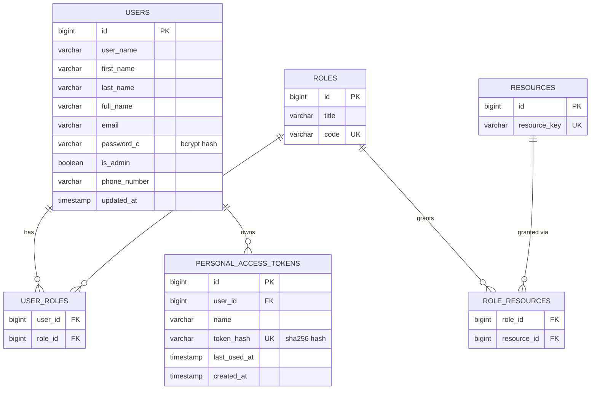

# User Management

How authentication, authorization, users, roles, and permissions work in Fanoos.

## Concepts

- **User** (`users`) — an account with a username/password. A user can be flagged `is_admin`, which bypasses all permission checks.
- **Role** (`roles`) — a named bundle of permissions (e.g. `admin`, `editor`). Identified by a unique `code`.
- **Resource** (`resources`) — a single permission/action in the system, identified by a unique `resource_key` (e.g. `users.create`, `roles.view`). Seeded in migration `000003_create_resources_table`.
- **Role → Resource** (`role_resources`) — which resources a role grants.
- **User → Role** (`user_roles`) — which roles a user has. A user's effective permissions are the union of all resources granted by all of their roles.
- **Personal Access Token** (`personal_access_tokens`) — a long-lived bearer credential a user can create for API/script access, as an alternative to logging in for a JWT.

## Authentication

Handled by `internal/app/auth`.

- `POST /api/login` — takes `{ username, password }`. The stored bcrypt hash for the user is fetched via `getUserData` (registered by `internal/app/users/service.go` through `auth.RegisterGetUserData`, to avoid an import cycle between `auth` and `users`). The password is checked with `bcrypt.CompareHashAndPassword`. On success, a JWT is issued via `GenerateToken`, signed with HS256, valid for 24 hours, carrying the `username` claim.
- Passwords are hashed with **bcrypt** (`bcrypt.GenerateFromPassword`, `bcrypt.DefaultCost`) — see `internal/app/users/service.go:HashPassword`. Any script that inserts a user directly (e.g. a migration) must hash the password the same way.
- Personal access tokens (`internal/app/patoken`) are an alternate credential: a random 64-byte token prefixed `mkt_pat_` is generated, and only its **SHA-256 hash** is stored (`token_hash`). The raw token is shown once at creation time and cannot be retrieved again.

Every authenticated request sends `Authorization: Bearer <credential>`, where `<credential>` is either a JWT from `/api/login` or a raw personal access token.

## Authorization

Handled by `internal/app/auth/middleware.go`, applied per-route.

- `JWTMiddleware()` — just requires *some* valid credential (JWT or PAT) and attaches `userId`/`username` to the Gin context. Used for endpoints that only need "is logged in" (e.g. managing your own personal access tokens).
- `RequireResource(resourceKey)` — requires a valid credential **and** permission to a specific resource. Resolution order:
  1. Parse the bearer token as a JWT (`ValidateToken`). If that fails, fall back to treating it as a personal access token (`patoken.ValidateToken`, hash-and-lookup).
  2. Look up the resolved user's `is_admin` flag — if true, access is always granted.
  3. Otherwise, check whether any of the user's roles (`user_roles`) grant the requested resource (`role_resources` → `resources.resource_key`) via a single joined `COUNT(1)` query.

```
credential resolves to a user
        │
        ▼
  is_admin = true? ──yes──▶ allowed
        │no
        ▼
  user_roles ⋈ role_resources ⋈ resources
  WHERE resource_key = <required>
        │
        ▼
  count > 0? ──yes──▶ allowed
        │no
        ▼
     403 Forbidden
```

## Managing users, roles, and permissions

All under `/api`, JSON in/out, via `internal/app/{users,role,roleresource}`:

| Endpoint | Purpose |
|---|---|
| `POST /users/create` | Create a user (password is hashed server-side before insert) |
| `POST /users/delete` | Delete users by id |
| `POST /roles/create` | Create a role (`title`, `code`) |
| `POST /roles/delete` | Delete roles by id |
| `POST /role-resources/assign` | Grant a role a set of resources |
| `POST /role-resources/remove` | Revoke a set of resources from a role |
| `POST /role-resources/list` | List the resources currently granted to a role |
| `POST /personal-access-tokens/create` | Create a PAT for the current user |
| `POST /personal-access-tokens/delete` | Revoke PATs owned by the current user |
| `POST /personal-access-tokens/list` | List the current user's PATs (never returns the raw token) |
| `POST /dataviews/all-users` \| `all-roles` \| `all-resources` | Paginated listing (see `internal/app/dataviews`) |

Note: assigning a user to a role happens by inserting directly into `user_roles` — there is currently no dedicated `/user-roles` endpoint; roles are attached via SQL/migrations (see the `admin` user seeded in migration `000007`, which relies on `is_admin` rather than a role).

## Database design



`user_roles` and `role_resources` are pure join tables with a composite primary key (`user_id, role_id` / `role_id, resource_id`) and `ON DELETE CASCADE`, so deleting a user, role, or resource automatically cleans up its associations.

## Known limitations

- The JWT signing secret is hardcoded in `internal/app/auth/auth.go` (`your-secret-key`) rather than sourced from configuration/environment — fine for local dev, not for production.
- There is no endpoint to assign/remove a user's roles (`user_roles`); it must be done via direct SQL or a migration.
